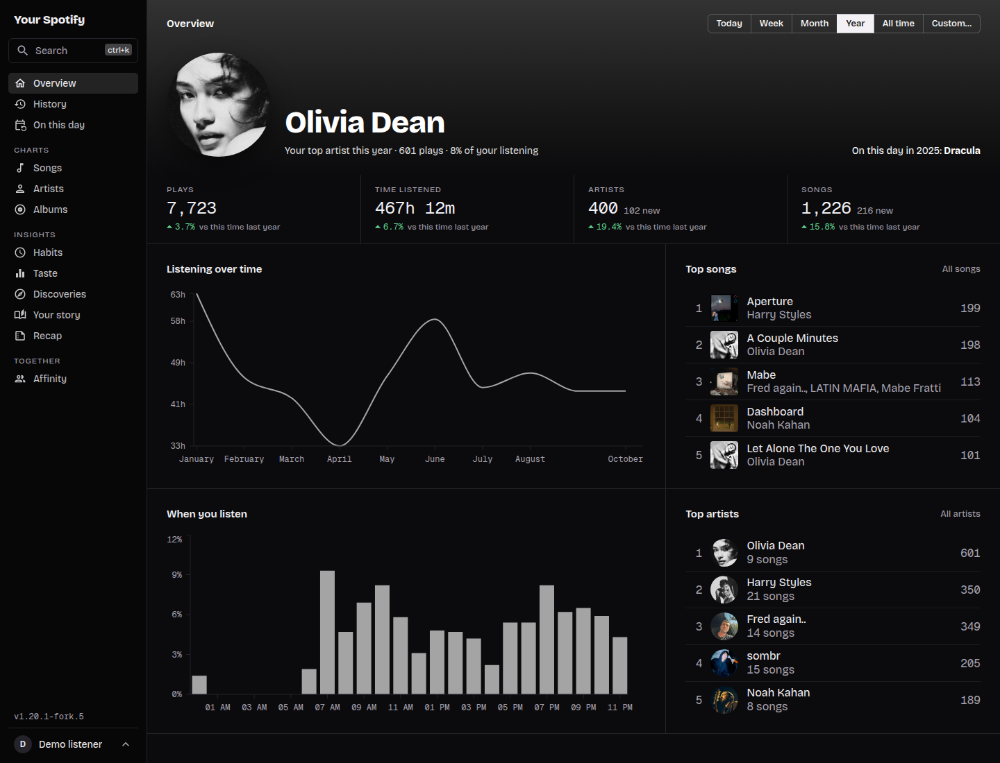
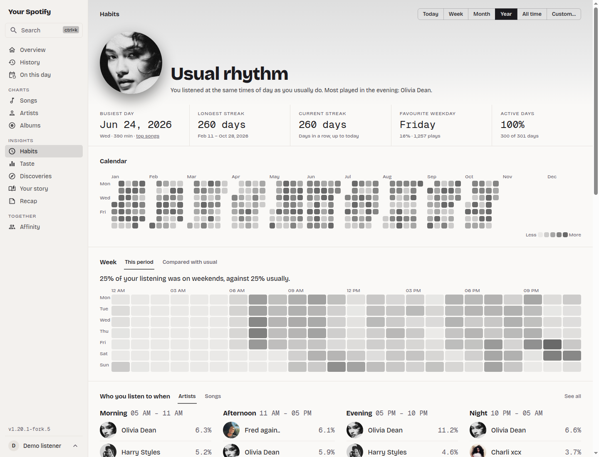
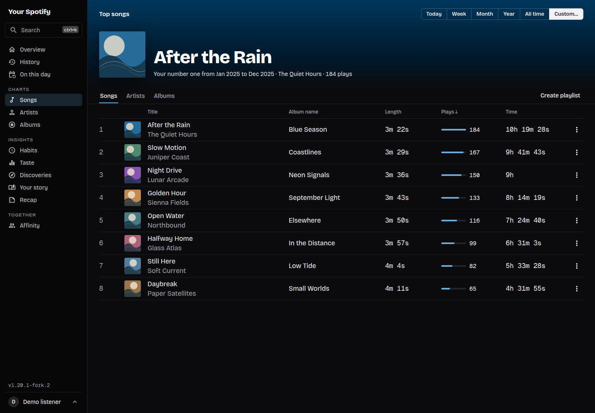
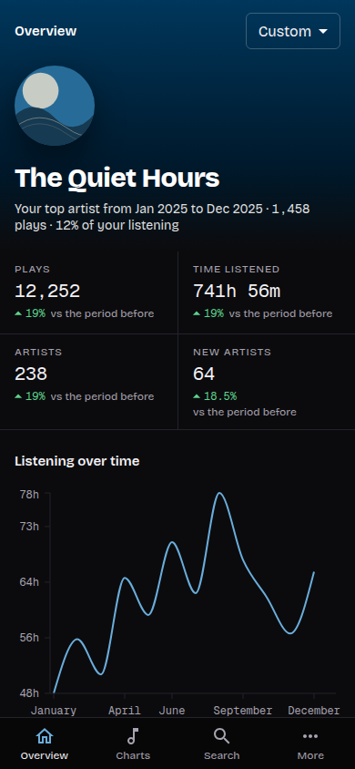

<p align='center'>
  
</p>
<p align="center">
  <sub>Overview <a href="#screenshots">More screenshots</a></sub>
</p>

# Your Spotify

**YourSpotify** is a self-hosted application that tracks what you listen to and gives you a dashboard to explore statistics about it.
It consists of a server that regularly asks Spotify what you played and stores it and a web app where you browse your statistics.

> **This is a fork** of [Yooooomi/your_spotify](https://github.com/Yooooomi/your_spotify), maintained since April 2026. I try to stay in sync with upstream regularly. Coming from the original project? See [Switching from the original YourSpotify](#switching-from-the-original-yourspotify). This fork adds:
>
> - **Complete redesign** - a consistent layout on every page, page colors taken from album and artist artwork, dark and light themes, clearer statistics with comparisons to the previous period and a layout that works on tablets and phones
> - **New insight pages** - **Taste** (genres, release years and decades, your musical age over time), **Habits** (streaks, a listening calendar, time of day, longest listening sessions), **Discoveries** (new artists and songs, comebacks, songs on repeat), **Your story** (forgotten favorites, eras, evergreen songs) and **On this day**. They replace upstream's "All stats" page
> - **Recap** - a yearly summary compared with the previous year, with a shareable image
> - **Playlists from insights** - lists like songs on repeat, forgotten favorites and evergreen songs can be saved as a Spotify playlist
> - **Track deduplication by ISRC** - different releases of the same song (single, album, remaster) count as one song with a combined listen history. Older history is merged from the admin settings, with a preview first
> - **Multi-artist support** - every credited artist is shown and artists you only heard as a featured artist get their own page and appear in search
> - **Listened album context** - track and history views show which album version you actually played a song from
> - **Remove wrong listens** - take a listen out of your statistics, for example a song Spotify recorded although you skipped it right away, with Undo and a list in the settings to restore it later
> - **Genres from MusicBrainz** - Spotify no longer returns genres to new apps, so the server looks them up on [MusicBrainz](https://musicbrainz.org) in the background. Genres Spotify returned before are kept
> - **Spotify rate limit handling** - a configurable pause between Spotify requests makes bans less likely. If Spotify does ban the app for a while, imports pause and continue on their own afterwards, logins tell you until when instead of hanging and your stats stay usable
> - **Better Spotify auth handling** - when Spotify revokes your access, the app asks you to log in again instead of silently stopping to record
> - **More reliable imports** - imports no longer drop listens, resume from the right place after a failure and keep their uploaded files across updates, so a failed import can still be retried
> - **Smaller, safer Docker images** - both containers run without root rights, the web app is served by Nginx with long-term browser caching and the server image ships Node.js without npm or build tools
> - Many smaller fixes, for example to infinite scroll, the album page and search
>
> This is a personal fork, not affiliated with or supported by the upstream project. It comes with **no warranty**: back up your database before upgrading and use it at your own risk.

## Table of contents

- [Screenshots](#screenshots)
- [Prerequisites](#prerequisites)
- [Installation](#installation)
  - [1. Choose how to access YourSpotify](#1-choose-how-to-access-yourspotify)
  - [2. Create the Spotify application](#2-create-the-spotify-application)
  - [3. Start YourSpotify with Docker Compose](#3-start-yourspotify-with-docker-compose)
  - [4. First start](#4-first-start)
- [Importing past history](#importing-past-history)
- [Updating](#updating)
- [Switching from the original YourSpotify](#switching-from-the-original-yourspotify)
- [Using the dashboard](#using-the-dashboard)
- [Advanced setup](#advanced-setup)
  - [Environment variables](#environment-variables)
  - [Advanced CORS settings](#advanced-cors-settings)
  - [Building the images yourself](#building-the-images-yourself)
  - [Installing locally (not recommended)](#installing-locally-not-recommended)
- [FAQ](#faq)
- [External guides](#external-guides)
- [Contributing](#contributing)
- [Supporting the original project](#supporting-the-original-project)
- [License](#license)

## Screenshots

The screenshots use fictional listening data, names and artwork. Click an image to view it at full size.

| Habits · light theme                                                                                                                                                           | Song charts · dark theme                                                                                                                               |
| ------------------------------------------------------------------------------------------------------------------------------------------------------------------------------ | ------------------------------------------------------------------------------------------------------------------------------------------------------ |
| [](docs/screenshots/habits-light.png) | [](docs/screenshots/charts-dark.png) |

On phones, the dashboard switches to a single column with navigation along the bottom:

<p align="center">
  <a href="docs/screenshots/overview-mobile.png"></a>
</p>

## Prerequisites

1. A machine with [Docker](https://docs.docker.com/get-started/get-docker/) and Docker Compose (the `docker compose` command). If you want to run it without Docker, see the [local installation guide](LOCAL_INSTALL.md).
2. A Spotify account with **Premium**. Spotify requires the owner of a developer app to have Premium and allows up to 5 users per app (see [Spotify's current rules](https://developer.spotify.com/documentation/web-api/concepts/quota-modes)).

## Installation

### 1. Choose how to access YourSpotify

YourSpotify has two addresses: the web app (port `3000`) and the server, also called the API (port `8080`). Your browser needs to reach both. Decide first how you will open them, because the Spotify application needs the server address.

> **A plain local IP address does not work.** Spotify only allows logins to come back over plain `http://` to a loopback address such as `127.0.0.1`. An address like `http://192.168.1.50:8080` is refused. Use one of the three options below.

#### Option A: On the machine running Docker

Keep the `127.0.0.1` values from the compose file and open `http://127.0.0.1:3000`. Spotify redirect URI:

```text
http://127.0.0.1:8080/oauth/spotify/callback
```

#### Option B: From another device, through an SSH tunnel

Keep the `127.0.0.1` values and make sure SSH is enabled on the Docker host. On the device you browse from, run this command and keep it open:

```bash
ssh -N -L 3000:127.0.0.1:3000 -L 8080:127.0.0.1:8080 pi@192.168.1.50
```

Replace `pi` and `192.168.1.50` with the host's SSH username and local IP address, then open `http://127.0.0.1:3000`. Use the same Spotify redirect URI as in option A.

The tunnel is only needed while you browse: the server keeps recording your listens either way. This works well from a laptop; for regular use from a phone, option C is easier.

#### Option C: Through an HTTPS reverse proxy

Set up Nginx, Caddy, Traefik or another proxy with two HTTPS addresses: one forwarding to port `3000` (the web app) and one forwarding to port `8080` (the API). Then use these addresses in the compose file, for example:

```yml
server:
  environment:
    API_ENDPOINT: https://api.yourspotify.example.com
    CLIENT_ENDPOINT: https://yourspotify.example.com

web:
  environment:
    API_ENDPOINT: https://api.yourspotify.example.com
```

Spotify redirect URI: `https://api.yourspotify.example.com/oauth/spotify/callback`, which is your `API_ENDPOINT` followed by `/oauth/spotify/callback`.

For Nginx, [docs/nginx-example.conf](docs/nginx-example.conf) is a complete example with both addresses, including notes for Cloudflare Tunnel.

Things to keep in mind for the proxy:

- Both addresses must be under the same domain, as in the example. The login cookie is not sent between unrelated domains, so you would be logged out on every request.
- A history import uploads up to 50 files of 20 MB each in one request. Some proxies limit uploads by default (Nginx to 1 MB, raise it with `client_max_body_size`, for example to `1024m`).

### 2. Create the Spotify application

1. Open the [Spotify Developer Dashboard](https://developer.spotify.com/dashboard/applications) and click **Create app**.
2. Fill out the application information.
3. Enter the redirect URI from the access option you chose above.
4. Check **Web API** and **I understand and agree**, then create the application.
5. Open **Settings** and copy the client ID and client secret. You will use them as `SPOTIFY_PUBLIC` and `SPOTIFY_SECRET` in the compose file.
6. If other people will use your instance, add their Spotify accounts under **User Management**. The account that created the application is added automatically.

### 3. Start YourSpotify with Docker Compose

Create a `compose.yaml` file like the one below (also available as [docker-compose-example.yml](docker-compose-example.yml)). Replace the Spotify credentials and, if you chose option C, the endpoint values.

```yml
services:
  server:
    image: ghcr.io/thetastyhanuta/your_spotify_server:latest
    init: true
    restart: always
    ports:
      - "8080:8080"
    depends_on:
      - mongo
    volumes:
      - imports:/tmp/imports
    environment:
      API_ENDPOINT: http://127.0.0.1:8080 # This MUST be included as a valid URL in the Spotify dashboard (see above)
      CLIENT_ENDPOINT: http://127.0.0.1:3000
      SPOTIFY_PUBLIC: __your_spotify_client_id__
      SPOTIFY_SECRET: __your_spotify_secret__

  mongo:
    image: mongo:8
    restart: always
    volumes:
      - ./your_spotify_db:/data/db

  web:
    image: ghcr.io/thetastyhanuta/your_spotify_client:latest
    init: true
    restart: always
    ports:
      - "3000:3000"
    environment:
      API_ENDPOINT: http://127.0.0.1:8080

volumes:
  imports:
```

> **Older CPUs and ARM devices:** MongoDB 5.0 and newer need a CPU with ARMv8.2-A (ARM) or AVX (x86-64). On older hardware, for example a Raspberry Pi 4 or older, or some older x86 servers and virtual machines, the `mongo` container stops right after starting, often with exit code 132 or an "Illegal instruction" error in `docker compose logs mongo`. Use the image `mongo:4.4` instead. It no longer receives updates, so only use it when your hardware requires it.

The images are published on the GitHub Container Registry. `latest` is the newest release, `nightly` follows the `master` branch.

Start YourSpotify from the directory containing the file:

```bash
docker compose up -d
```

Check that all three containers are running with `docker compose ps`. If one keeps restarting, `docker compose logs server` (or `mongo`, `web`) shows why.

### 4. First start

1. Open the web app (`http://127.0.0.1:3000`, or your frontend address with option C) and log in with Spotify.
2. **The first account that logs in becomes the administrator.**
3. Play a song on Spotify. The server checks for new listens every few minutes, so it shows up on the **History** page shortly after.
4. YourSpotify records your listening from now on, plus roughly the day before you logged in. To get your older history, [import it](#importing-past-history).
5. If you are the only user, turn off new registrations in **Settings → Admin → Allow registrations**.

If the login fails with `INVALID_CLIENT: Invalid redirect URI`, the redirect URI in the Spotify dashboard does not exactly match your `API_ENDPOINT` followed by `/oauth/spotify/callback`.

## Importing past history

Spotify only lets apps see your most recent plays, so everything before your registration has to be imported from a Spotify data export. Request the export on Spotify's [privacy page](https://www.spotify.com/us/account/privacy/), then open **Settings → Account → Import data** in YourSpotify.

| Method                                       | What you get                                      | Spotify takes up to | Files to upload                            |
| :------------------------------------------- | :------------------------------------------------ | :------------------ | :----------------------------------------- |
| **Extended streaming history** (recommended) | Your whole history since you created your account | 30 days             | `Streaming_History_Audio_YYYY-YYYY_X.json` |
| **Account data**                             | The last year only                                | 5 days              | `StreamingHistoryX.json`                   |

Choose the method matching your export, upload the files (up to 50 files, 20 MB each) and start the import. A large history can take several hours, because the server waits between Spotify requests to avoid being rate limited. You can keep using the dashboard meanwhile; the page header shows the progress.

It is best to import right after creating your account. YourSpotify detects duplicate listens, but a few may still be inserted twice.

### When Spotify blocks the import

If Spotify rate limits the app for a long time, the import pauses instead of failing. The page header and the import history in **Settings** show until when Spotify blocks requests. A few minutes after that, the import continues on its own from where it stopped. The pause leaves the polling of your recent listens time to catch up first. Imports send their requests a bit slower than the rest of the app (one every 1.5 × `SPOTIFY_API_DELAY_MS`, 3 seconds by default), and after every such block 1.5 times slower again, down to one request every 16 × `SPOTIFY_API_DELAY_MS` (32 seconds by default), so they are less likely to get the app blocked again. A large import can therefore take days; you only have to start it once. An import that was running when the server stopped continues a few minutes after the server starts again.

To stop a paused import, choose **Cancel** in the menu next to it in **Import history**. This deletes its uploaded files.

### When an import fails

An import fails if a Spotify request fails 10 times in a row, if your Spotify login is no longer valid, or if its files cannot be read.

To retry a failed import, open **Settings → Account → Import data**, then the menu next to the import in **Import history** and choose **Retry**. **Clean up** deletes the import and its uploaded files, so only use it if you do not want to retry.

The uploaded files are kept in the `imports` volume from the [example compose file](#3-start-yourspotify-with-docker-compose), so a paused or failed import can still continue after a restart or an update. Without that volume, an update replaces the container and the import needs its files uploaded again.

## Updating

Back up your database first (see [step 1 below](#1-back-up-your-database)). Then run these commands in the directory containing your compose file:

```bash
docker compose pull
docker compose up -d
```

Database changes are applied automatically when the server starts. Running and paused imports continue a few minutes after the server is back, and the duplicate song lookup continues where it stopped. Imports need the `imports` volume from the [example compose file](#3-start-yourspotify-with-docker-compose) for that; without it, upload their files again.

## Switching from the original YourSpotify

You keep your database, settings and Spotify application. Only the two app images change.

The commands below assume the service names from the example compose file (`server`, `web` and `mongo`) and the default database name `your_spotify`. If yours differ (check with `docker compose config --services` and the last part of `MONGO_ENDPOINT` is the database name), replace them in every command. If your database runs elsewhere or needs a password, make the backup with the tools you normally use for it.

#### 1. Back up your database

Do this **before** switching. The new server changes the database as soon as it starts, so a later backup is no longer your original database. Stop the app first, so nothing is written during the backup:

```bash
docker compose stop server web
docker compose exec mongo mongodump --archive=/tmp/your_spotify.archive --db your_spotify
docker compose cp mongo:/tmp/your_spotify.archive ./your_spotify.archive
```

Check that `your_spotify.archive` exists and is not empty and keep it until you are happy with the switch.

#### 2. Change the images

In your compose file, replace the two app images and leave everything else as it is. In particular, do not change the `mongo` image: MongoDB cannot open data files from a much older major version.

| Service  | Original project               | This fork                                           |
| -------- | ------------------------------ | --------------------------------------------------- |
| `server` | `yooooomi/your_spotify_server` | `ghcr.io/thetastyhanuta/your_spotify_server:latest` |
| `web`    | `yooooomi/your_spotify_client` | `ghcr.io/thetastyhanuta/your_spotify_client:latest` |

```bash
docker compose pull server web
docker compose up -d
```

Watch the server log with `docker compose logs -f server` until it prints `Migrations successfully ran`, then press Ctrl+C. Open the web app and check that your accounts and older listening history are still there and that a song you play now shows up on the **History** page after a few minutes.

#### Coming from the linuxserver.io image

The [linuxserver.io image](https://github.com/linuxserver/docker-your_spotify) runs the server and the web app in one container, with the API under `/api`. This fork has no such image, so the setup changes:

1. Back up your database as in step 1, stopping the linuxserver.io container instead of `server web`.
2. Replace the linuxserver.io container with the `server` and `web` services from the [example compose file](#3-start-yourspotify-with-docker-compose). Keep your existing Mongo container and its data. Do not add the example's `mongo` service and remove `depends_on` if your database is not a service in the same compose file.
3. Set `MONGO_ENDPOINT` on the server to your existing database. The server must be able to reach it, for example by being in the same compose file or Docker network.
4. The API now has its own address (port `8080`). Choose an [access option](#1-choose-how-to-access-yourspotify), update your reverse proxy and change the redirect URI in the Spotify dashboard: it no longer contains `/api`.

#### 3. Optional: merge duplicate tracks

New listens are matched by ISRC automatically, but your existing history still contains duplicate songs (for example a single and the album version). An admin can merge them in **Settings → Admin → Merge duplicate songs**:

1. **Start** the lookup. The server asks Spotify for the ISRC of every older song in the background, one song every few seconds, so a large history takes a day or more. It pauses while an import runs or Spotify blocks requests, continues after restarts, and nothing changes in your stats meanwhile.
2. Check the preview: every song with several versions, the version that stays (the one with the most listens) and how many listens move. It fills up while the lookup runs.
3. **Merge** applies the preview for every user on the server. Take a backup first: only a backup can undo it. Album stats keep the album each listen was played from. You can merge again later for songs found after that.

#### Going back

To return to the original project, stop the app and restore your backup:

```bash
docker compose stop server web
docker compose cp ./your_spotify.archive mongo:/tmp/your_spotify.archive
docker compose exec mongo mongorestore --drop --archive=/tmp/your_spotify.archive --nsInclude='your_spotify.*'
```

Then change the two images back to `yooooomi/your_spotify_server` and `yooooomi/your_spotify_client` and run `docker compose pull server web` and `docker compose up -d`. Listens recorded since the backup are lost, except the last roughly 50 plays that Spotify still returns.

## Using the dashboard

- Choose a preset or custom date range in the page header. The period is part of the page address, so a bookmark opens the same range. **Your story** always covers your whole history, **On this day** looks at today's date in earlier years and **Recap** has its own year picker.
- **Settings**, **Share this page** and **Log out** are in the account menu at the bottom of the sidebar, or under **More** on phones. Settings holds your theme, timezone, date format, artist blacklist, removed listens, imports and the choice between play counts and listening time. Administrators also manage accounts and registrations there.
- To remove a listen that should not count, right-click it on the **History** page (or on an artist's, album's or song's list of listens), use its ⋮ menu, or long-press it on a phone, then choose **Remove listen**. Select several rows first (Shift or Ctrl, Cmd on a Mac) to remove them together. Removed listens count nowhere; restore them under **Settings → Statistics → Removed listens**.
- To share your statistics, create a public token in **Settings → Account → Public token**, then use **Share this page**. **Anyone with the link can browse all your statistics**, not only the page you shared, until you delete or regenerate the token.

## Advanced setup

### Environment variables

All variables are set on the **server**, except `FRAME_ANCESTORS`, which belongs to the **web** container and `API_ENDPOINT`, which both need.

| Key                   | Default value (if any)             | Description                                                                                                                                                                                                           |
| :-------------------- | :--------------------------------- | :-------------------------------------------------------------------------------------------------------------------------------------------------------------------------------------------------------------------- |
| CLIENT_ENDPOINT       | REQUIRED                           | The address of your web application                                                                                                                                                                                   |
| API_ENDPOINT          | REQUIRED                           | The address of your server                                                                                                                                                                                            |
| SPOTIFY_PUBLIC        | REQUIRED                           | The client ID of your Spotify application (see [Create the Spotify application](#2-create-the-spotify-application))                                                                                                   |
| SPOTIFY_SECRET        | REQUIRED                           | The client secret of your Spotify application (see [Create the Spotify application](#2-create-the-spotify-application))                                                                                               |
| TIMEZONE              | Europe/Paris                       | The default timezone of your stats. Each user can change it in the settings. Only affects how stats are computed, since data is saved in UTC                                                                          |
| MONGO_ENDPOINT        | mongodb://mongo:27017/your_spotify | The address of the Mongo database, where **mongo** is the name of your service in the compose file                                                                                                                    |
| PROMETHEUS_USERNAME   | _not defined_                      | Prometheus basic auth username (see [here](apps/server/README.md#prometheus))                                                                                                                                         |
| PROMETHEUS_PASSWORD   | _not defined_                      | Prometheus basic auth password                                                                                                                                                                                        |
| LOG_LEVEL             | info                               | The log level, debug is useful if you encounter any bugs                                                                                                                                                              |
| CORS                  | _not defined_                      | List of comma-separated origins allowed (not required; defaults to CLIENT_ENDPOINT)                                                                                                                                   |
| COOKIE_VALIDITY_MS    | 30d                                | How long a login stays valid, following [this pattern](https://github.com/vercel/ms). It is renewed while you keep using the app, so it only runs out when a device is not used for that long                         |
| MAX_IMPORT_CACHE_SIZE | 100000                             | The maximum number of cached items per user during an import. A larger cache reduces Spotify requests and can make imports faster                                                                                     |
| MONGO_NO_ADMIN_RIGHTS | false                              | Do not ask for admin rights on the Mongo database                                                                                                                                                                     |
| PORT                  | 8080                               | The port of the server, **do not** modify if you're using Docker                                                                                                                                                      |
| FRAME_ANCESTORS       | _not defined_                      | Sites allowed to frame the website, comma separated list of URLs (`i-want-a-security-vulnerability-and-want-to-allow-all-frame-ancestors` to allow every website)                                                     |
| SPOTIFY_API_DELAY_MS  | 2000                               | Minimum delay in milliseconds between Spotify requests (imports, polling, login). A longer delay makes Spotify rate limits less likely, but imports slower. Imports and the ISRC lookup add their own wait on top     |
| DISABLE_POLLING       | false                              | Stop fetching recently played tracks from Spotify every few minutes, for example when you only use imports or while Spotify rate limits the app. Imports and the Spotify login still work                             |

### Advanced CORS settings

**Manually specifying CORS configuration is not required for typical deployments.**
99.9% of users do not need to worry about this, it is handled automatically.

If your use case requires the backend to be used from multiple frontend origins, you can manually adjust the `CORS` variable.
For example, a value of `origin1,origin2` will allow `origin1` and `origin2`.

### Building the images yourself

If you prefer not to use the published images, you can build them from this repository:

```bash
git clone https://github.com/TheTastyHanuta/your_spotify.git
cd your_spotify
docker build -f Dockerfile.server.production -t your_spotify_server .
docker build -f Dockerfile.client.production -t your_spotify_client .
```

Then use `your_spotify_server` and `your_spotify_client` as the `image` of the `server` and `web` services in your compose file.

### Installing locally (not recommended)

You can follow the instructions [here](LOCAL_INSTALL.md). Note that you still need the [Spotify application](#2-create-the-spotify-application).

## FAQ

### The login fails with "INVALID_CLIENT: Invalid redirect URI"

The redirect URI in the Spotify dashboard must be exactly your `API_ENDPOINT` followed by `/oauth/spotify/callback`, including `http`/`https` and the port. Also see [Choose how to access YourSpotify](#1-choose-how-to-access-yourspotify): a plain local IP address over `http://` is not accepted by Spotify.

### The web application is telling me it cannot retrieve global preferences

The web app can't reach the server. Check that the `API_ENDPOINT` address is reachable from the device you are browsing from.

### Spotify rate limited the app. What now?

Spotify sometimes blocks an app for several hours, especially after large imports. Logins and imports then show until when the block lasts and your existing stats stay usable as long as you are logged in. Imports and the duplicate song lookup pause and continue on their own a few minutes after the block ends, and they slow down after every block; only a login has to be retried. If it happens often, raise `SPOTIFY_API_DELAY_MS`; you can also set `DISABLE_POLLING` while you wait.

### Songs don't seem to synchronize anymore

This can happen if you revoked access on your Spotify account. The page header usually asks you to log in again. Otherwise, go to **Settings → Account → Miscellaneous** and click **Relog** next to **Relog to Spotify**.

### How can I block new registrations?

From an admin account, go to **Settings → Admin → Allow registrations** and set **Allow new registrations** to **NO**.

### A user is not in the same timezone as the server, how can they use their own timezone?

Any user can set their own timezone in the settings, it will be used for any computed statistics. The timezone of the device will be used for everything else, such as song history.

## External guides

- [BreadNet](https://breadnet.co.uk/your-spotify-2022) installation tutorial (written for the original project)

## Contributing

If you found a bug in this fork or have an idea, feel free to open an [issue](https://github.com/TheTastyHanuta/your_spotify/issues/new/choose). If the problem also happens with the original project, please report it [there](https://github.com/Yooooomi/your_spotify/issues) as well.

## Supporting the original project

**YourSpotify** is created by [Yooooomi](https://github.com/Yooooomi), who works on it in their spare time. If you find it useful, consider supporting the original project:

[](https://www.paypal.com/donate/?hosted_button_id=BLAPT49PK9A8G)

## License

**YourSpotify** is licensed under the [GNU General Public License v3.0](LICENSE). This fork is a modified version of [Yooooomi/your_spotify](https://github.com/Yooooomi/your_spotify), changed since April 2026 and is distributed under the same license. The commit history lists every change.
